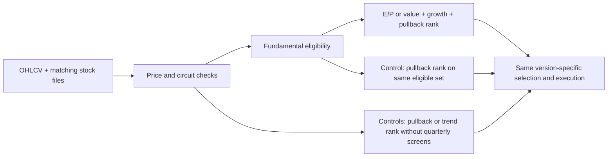

| Strategy logic | Normal value | Experimental value–growth–pullback |
| --- | --- | --- |
| Data and universe | Upstox OHLCV ∩ fundamentals JSON ∩ NSE valuation-price symbols; main and SME files; results usable next day; cutoff 31 Dec 2024. | Same source and timing rules. Neither uses a top-1,000 price × volume rank filter. |
| Other eligibility | Previous month-end NSE price > ₹20; ≤5 high=low days in prior 63 sessions; lagged prior-month return ≥ −15%; at least 60 eligible stocks. | Same; high=low is only a circuit proxy. CA-unit mask can exclude uncertain share counts. |
| Fundamental factor | TTM net profit from four consecutive quarters ÷ (as-traded price × filed shares); TTM profit > 0, latest-quarter YoY profit growth > 0 and E/P ≤50%. | Same eligibility. Earnings-yield and latest-quarter symmetric YoY growth are percentile-ranked as separate scoring components. |
| OHLCV contribution | Price and circuit/falling-knife filters, 21-day volatility sizing, benchmark/regime, risk and close-based stops. No OHLCV score in ranking. | Same plus pullback score from relative strength versus its 252-session peak and proportion of recent closes above SMA50. |
| Ranking | Highest E/P first; monthly cross-sectional z-scoring preserves its order. | 55% E/P rank + 20% profit-growth rank + 25% inverse A3/Q5 price-strength rank. Missing secondary leg receives neutral percentile. |
| Stock selection | Top 20 entries; previous monthly selections may remain through rank 40, subject to 10-rank swap gap. | Same 20/40/10 selection rules; actual holdings and target selections can temporarily differ. |
| Rebalancing | Month-end close signal; next session open execution. Defers first two consecutive monthly target drops; exit on the third. | Same timing; defers first three drops, exits on the fourth. Rebalances continuing holdings on a new month signal or risk-scale change; missing-open resizes retry. |
| Position sizing | Inverse 21-session volatility; 0.75% risk budget ÷ 15% entry stop = 5% maximum target weight. 20 × 5% permits up to 100% before overlays. | Same cap and 20 positions. Risk adjustments, missing quotes, insufficient eligible stocks and cash-funded trading fees can reduce exposure. |
| Portfolio and cash | Unused weight earns a modeled 6.5% p.a. liquid-fund rate; 0.30% one-way turnover cost. No capacity cap by default. | Same cash-rate and cost assumptions; actual modeled opening trades and drifting weights drive transaction costs. No default capacity cap. |
| Market and volatility risk | Benchmark = equal-weight daily returns of loaded OHLCV symbols with a fundamentals filename, not Nifty. Bear multiplier 0.8; volatility target 20%. | Same benchmark; bear multiplier 0.5; volatility target 22%. Both use correlation guard, monthly panic exposure and daily crash guard. |
| Stop loss | 15% below entry and 20% below peak close; tighter effective stop ratchets up. Checked at close after five calendar days, executed at the next valid open. | Same. No ATR chandelier stop or fixed take-profit by default. Gap can produce a worse fill than the trigger. |
| Re-entry cooldown | Losing stop: 20 × loss % / 10, capped at 10–60 calendar days. Crash guard imposes a separate 10-session portfolio cooldown. | Same. Profitable stop has no loss-scaled cooldown by default. |
| Exit logic | Close-confirmed stop, persistent monthly target drop, crash guard, or final-period mark. Fundamental eligibility failure can be delayed by the rebalance buffer. | Same exit types, with the longer three-drop buffer. End-of-period marks are not sales. |
| Return accounting | Target-weight based; daily target reweighting / turnover limitation remains in the normal runner. Full exits have zero exit-day stock weight. | Execution book marks open/close holdings and charges modeled trades. Reported returns attribute overnight/intraday holdings, but omit full-exit stock contribution on exit day. |

## Reading the answer

**The result depends on the technical comparison.** In both engines, the fundamental strategy beat pullback-only ranking on the same fundamentally eligible stocks. Against the broader price-trend control, however, both fundamental versions had lower CAGR and deeper drawdown in this history. They had higher closed-trade win rates, illustrating that a higher win rate does not necessarily produce a higher portfolio return. See the numerical comparisons and winner sizes below.

These tests measure historical associations under specified controls; they do not establish that fundamentals universally cause better results or predict future performance. The two production versions have different risk settings and accounting, so compare cases **within the same engine**, not across the normal and experimental columns. The sample and parameters were previously researched; 2022–2024 is a previously examined comparison, not an untouched holdout.

[[PERFORMANCE_CHART]]

## How the analysis separates fundamentals from OHLCV

1. **Fundamental strategy**: the version's current ranking and quarterly eligibility checks.
2. **Pullback · common eligible**: replace its fundamental ranking with the experimental version's OHLCV pullback rank but keep the same monthly, point-in-time fundamental eligibility. This tests the ranking change *conditional on the fundamental screen*; it is not a no-fundamentals portfolio.
3. **Pullback · price-only rules**: use the same pullback score but remove quarterly-profit, earnings-yield, filing-age and share-count eligibility; keep the OHLCV price/circuit/falling-knife rules.
4. **Trend · price-only rules**: rank the same A3/Q5 price-strength inputs in the opposite direction, preferring stronger rather than weaker price action; retain the same price-only eligibility.

Each comparison retains that version's max positions, stops, timing, portfolio/risk rules, cash and cost assumptions. The technical tests begin at the same first eligible signal month as the fundamental strategy, July 2019. Both price-only controls still use the fixed list of OHLCV symbols that have a fundamentals file and at least one available quarterly-result record in the historical corpus, plus the available NSE valuation-price symbol list. This is not a point-in-time, unrestricted market universe; the list can have survivorship and future-membership bias. The tests therefore do not measure fundamentals in every possible technical strategy. A3/Q5 use forward-filled closes and neutral ranks for missing secondary inputs, matching the existing experimental construction.

## Portfolio results: each control uses the same engine as its baseline

| Engine | Selection | CAGR | Max DD | Sharpe | Avg stock exposure | Annual turnover |
| --- | --- | --- | --- | --- | --- | --- |
| Normal | Fundamental strategy | 36.51% | -24.75% | 1.84 | 73.54% | 736.06% |
| Normal | Pullback · common eligible | 21.50% | -24.37% | 1.30 | 76.73% | 807.42% |
| Normal | Pullback · price-only rules | 20.87% | -29.35% | 1.21 | 74.21% | 902.68% |
| Normal | Trend · price-only rules | 39.01% | -23.22% | 1.99 | 72.01% | 775.63% |
| Experimental | Fundamental strategy | 38.32% | -18.43% | 1.89 | 73.17% | 724.34% |
| Experimental | Pullback · common eligible | 23.24% | -23.42% | 1.40 | 75.41% | 729.17% |
| Experimental | Pullback · price-only rules | 16.96% | -29.44% | 1.02 | 73.73% | 821.39% |
| Experimental | Trend · price-only rules | 42.24% | -15.65% | 2.14 | 72.68% | 663.78% |

CAGR and drawdown use the 3 June 2019–31 December 2024 daily return stream. The comparison compounds the first reporting-day return; the normal runner’s printed CAGR can differ by about 0.01 percentage points because it rebases at the first close. Turnover is total absolute buy plus sell weight changes. Normal turnover is the older target-weight estimate; experimental turnover is actual modeled open-trade turnover. Both assume 0.30% one-way cost and a 6.5% annual return on modeled idle cash.

[[PATHS_CHART]]

## Winners and losers: closed-trade price returns

| Engine | Selection | Closed | Winners / rate | Losers / rate | Flat | Mean winner | Mean loser |
| --- | --- | --- | --- | --- | --- | --- | --- |
| Normal | Fundamental strategy | 392 | 207 / 52.81% | 184 / 46.94% | 1 | +40.08% | -12.96% |
| Normal | Pullback · common eligible | 450 | 215 / 47.78% | 234 / 52.00% | 1 | +28.54% | -12.99% |
| Normal | Pullback · price-only rules | 507 | 235 / 46.35% | 271 / 53.45% | 1 | +27.87% | -13.50% |
| Normal | Trend · price-only rules | 429 | 218 / 50.82% | 209 / 48.72% | 2 | +39.26% | -13.36% |
| Experimental | Fundamental strategy | 376 | 209 / 55.59% | 165 / 43.88% | 2 | +36.31% | -12.82% |
| Experimental | Pullback · common eligible | 395 | 191 / 48.35% | 204 / 51.65% | 0 | +33.47% | -13.72% |
| Experimental | Pullback · price-only rules | 465 | 205 / 44.09% | 258 / 55.48% | 2 | +31.17% | -13.69% |
| Experimental | Trend · price-only rules | 357 | 184 / 51.54% | 173 / 48.46% | 0 | +43.59% | -13.42% |

A winner is a completed position with entry-to-exit price return > 0; a loser is < 0; flat equals 0. Rates use closed positions including flats in the denominator. Positions still open on 31 December 2024 are excluded. The return is an **unweighted price change**, not portfolio contribution or net return after all costs. Trade counts differ because the strategies enter different stocks and exit on different dates; a larger winner count alone does not establish improvement.

[[OUTCOMES_CHART]]

## Incremental differences: fundamental minus each control

| Engine | Control | Winner-rate Δ | Loser-rate Δ | Mean winner Δ | Mean loser Δ | CAGR Δ | Max-DD Δ |
| --- | --- | --- | --- | --- | --- | --- | --- |
| Normal | Pullback · common eligible | +5.03 pp | -5.06 pp | +11.55 pp | +0.03 pp | +15.01 pp | -0.38 pp |
| Normal | Pullback · price-only rules | +6.46 pp | -6.51 pp | +12.21 pp | +0.53 pp | +15.64 pp | +4.60 pp |
| Normal | Trend · price-only rules | +1.99 pp | -1.78 pp | +0.82 pp | +0.40 pp | -2.50 pp | -1.53 pp |
| Experimental | Pullback · common eligible | +7.23 pp | -7.76 pp | +2.84 pp | +0.89 pp | +15.08 pp | +4.99 pp |
| Experimental | Pullback · price-only rules | +11.50 pp | -11.60 pp | +5.14 pp | +0.87 pp | +21.36 pp | +11.00 pp |
| Experimental | Trend · price-only rules | +4.04 pp | -4.58 pp | -7.27 pp | +0.60 pp | -3.92 pp | -2.78 pp |

Differences are in percentage points. Positive max-DD Δ means the fundamental version had a smaller drawdown because drawdown is shown as a negative number. A positive mean-loser Δ means its average losing price return was less negative. These are descriptive strategy-level differences, not causal estimates: signals change which stocks are held, their weights, entry dates, exit dates, exposure and transaction costs.

### Matched stock-and-entry-date outcomes

| Engine | Control | Matched entries | Both win | Only fundamental wins | Only control wins | Neither wins | Mean trade-return Δ |
| --- | --- | --- | --- | --- | --- | --- | --- |
| Normal | Pullback · common eligible | 25 | 17 | 0 | 0 | 8 | +2.51 pp |
| Normal | Pullback · price-only rules | 0 | 0 | 0 | 0 | 0 | — |
| Normal | Trend · price-only rules | 0 | 0 | 0 | 0 | 0 | — |
| Experimental | Pullback · common eligible | 33 | 21 | 0 | 0 | 12 | +2.51 pp |
| Experimental | Pullback · price-only rules | 0 | 0 | 0 | 0 | 0 | — |
| Experimental | Trend · price-only rules | 0 | 0 | 0 | 0 | 0 | — |

A match uses the same ticker and entry date and excludes end-of-period marks. Exit dates can differ, so the return difference includes exit timing. A zero count means there were no directly matched entries for that pair. The matched subset omits all non-overlapping selections and is not representative of the entire opportunity set.

## Period breakdown

| Engine | Selection | Period | CAGR | Max DD | Win rate | Closed |
| --- | --- | --- | --- | --- | --- | --- |
| Normal | Fundamental strategy | 2019–21 | 31.76% | -24.75% | 51.12% | 178 |
| Normal | Fundamental strategy | 2022–24 (examined) | 40.86% | -17.56% | 53.61% | 194 |
| Normal | Fundamental strategy | 2024 | 27.32% | -13.75% | 57.14% | 56 |
| Normal | Pullback · common eligible | 2019–21 | 26.94% | -24.37% | 50.26% | 195 |
| Normal | Pullback · common eligible | 2022–24 (examined) | 17.06% | -22.69% | 45.96% | 235 |
| Normal | Pullback · common eligible | 2024 | 17.41% | -13.74% | 44.62% | 65 |
| Normal | Pullback · price-only rules | 2019–21 | 37.80% | -20.96% | 50.67% | 223 |
| Normal | Pullback · price-only rules | 2022–24 (examined) | 8.02% | -29.35% | 42.05% | 264 |
| Normal | Pullback · price-only rules | 2024 | 3.73% | -18.18% | 42.47% | 73 |
| Normal | Trend · price-only rules | 2019–21 | 54.24% | -23.22% | 52.10% | 167 |
| Normal | Trend · price-only rules | 2022–24 (examined) | 27.21% | -19.52% | 47.52% | 242 |
| Normal | Trend · price-only rules | 2024 | 31.92% | -10.68% | 42.86% | 63 |
| Experimental | Fundamental strategy | 2019–21 | 40.48% | -18.43% | 53.61% | 166 |
| Experimental | Fundamental strategy | 2022–24 (examined) | 36.61% | -17.86% | 55.79% | 190 |
| Experimental | Fundamental strategy | 2024 | 54.25% | -14.17% | 59.62% | 52 |
| Experimental | Pullback · common eligible | 2019–21 | 30.46% | -17.59% | 51.79% | 168 |
| Experimental | Pullback · common eligible | 2022–24 (examined) | 17.40% | -23.42% | 45.89% | 207 |
| Experimental | Pullback · common eligible | 2024 | 26.24% | -10.76% | 46.30% | 54 |
| Experimental | Pullback · price-only rules | 2019–21 | 31.54% | -16.77% | 46.80% | 203 |
| Experimental | Pullback · price-only rules | 2022–24 (examined) | 5.74% | -29.44% | 41.32% | 242 |
| Experimental | Pullback · price-only rules | 2024 | 0.28% | -22.85% | 36.23% | 69 |
| Experimental | Trend · price-only rules | 2019–21 | 58.19% | -15.02% | 50.68% | 146 |
| Experimental | Trend · price-only rules | 2022–24 (examined) | 29.91% | -15.65% | 48.69% | 191 |
| Experimental | Trend · price-only rules | 2024 | 25.01% | -14.11% | 35.19% | 54 |

Windows are slices of full-path portfolios, not fresh portfolios initialized on each boundary. Closed-trade windows require both entry and exit inside the window; an entry before the start or a position still open at the end is excluded from that window’s trade statistics. Both 2019–2021 and 2022–2024 influenced prior research.

### Paired return-stream sensitivity

| Engine | Control | 2.5th percentile CAGR Δ | Median Δ | 97.5th percentile Δ | Samples with Δ > 0 |
| --- | --- | --- | --- | --- | --- |
| Normal | Pullback · common eligible | +2.06 pp | +15.21 pp | +31.46 pp | 98.93% |
| Normal | Trend · price-only rules | -20.72 pp | -2.35 pp | +12.77 pp | 39.13% |
| Experimental | Pullback · common eligible | +2.46 pp | +15.23 pp | +29.45 pp | 98.87% |
| Experimental | Trend · price-only rules | -25.19 pp | -3.79 pp | +14.48 pp | 33.33% |

This resamples the already-realized paired daily return streams with 1,500 circular blocks of 126 sessions and a fixed seed. It does not rerun stock selection on a resampled market, correct for strategy search, or produce the probability of future outperformance. These are descriptive sensitivity ranges, not independent confidence intervals.

## Trade-log deep dive: current fundamental versions

### Normal value strategy

Completed positions: **392**. Median trade return: **+2.08%**; mean/median holding: **92.6 / 84.0 calendar days**. Median earnings yield at entry was **25.57%** for winners and **25.32%** for losers. The ten highest-return winners represent **24.78%** of the sum of positive *unweighted trade percentage returns*; this is not their share of portfolio profit.

Among winners, median maximum adverse excursion was **-3.52%** and median maximum favorable excursion was **+52.81%**. For losers the corresponding medians were **-16.26%** and **+8.09%**. These entry-to-intraday-low/high path measures are descriptive and can differ from the close-based stop trigger.

**Exit reasons**

| Reason | Closed | Win rate | Mean price return | Mean calendar days |
| --- | --- | --- | --- | --- |
| STOP_HIT | 268 | 37.31% | +2.53% | 70.6 |
| REBALANCE | 123 | 86.18% | +42.54% | 141.4 |
| CRASH_GUARD | 1 | 100.00% | +2.67% | 1.0 |

**Exit details**

| Detail | Closed | Win rate | Mean price return | Mean calendar days |
| --- | --- | --- | --- | --- |
| PEAK_HARD | 174 | 57.47% | +13.26% | 93.4 |
| ENTRY_HARD | 94 | 0.00% | -17.34% | 28.3 |
| SIGNAL_DROP | 92 | 85.87% | +35.64% | 140.3 |
| RANK_DECAY | 31 | 87.10% | +63.01% | 144.4 |
| BENCH_PANIC | 1 | 100.00% | +2.67% | 1.0 |

**Holding-period bands**

| Days held | Closed | Win rate | Mean price return |
| --- | --- | --- | --- |
| 1–30 | 83 | 2.41% | -15.64% |
| 31–90 | 126 | 42.06% | +2.75% |
| 91–180 | 138 | 80.43% | +23.20% |
| 181–365 | 44 | 90.91% | +82.52% |
| >365 | 1 | 100.00% | +30.70% |

**Entry regime**

| Regime | Closed | Win rate | Mean price return | Mean days |
| --- | --- | --- | --- | --- |
| BULL | 219 | 51.60% | +17.83% | 97 |
| BEAR | 104 | 53.85% | +13.36% | 87 |
| HIGH_VOL | 69 | 55.07% | +8.96% | 87 |

**SME-file check:** 0 of 392 completed positions (0.00%) match a ticker filename in `fundamentals/sme/`. This is a filename-based indicator, not a historical exchange-board classification; half-year-only filings generally fail the four-quarter requirement.

**Largest positive price-return trades**

| Ticker | Entry | Exit | Price return | Calendar days | Exit |
| --- | --- | --- | --- | --- | --- |
| GOODLUCK | 2021-01-25 | 2021-08-02 | +315.87% | 189 | REBALANCE |
| ESTER | 2020-06-01 | 2021-01-01 | +287.24% | 214 | REBALANCE |
| DALMIASUG | 2020-09-01 | 2021-07-01 | +255.79% | 303 | REBALANCE |
| RECLTD | 2022-12-22 | 2023-12-01 | +218.01% | 344 | REBALANCE |
| PFC | 2023-04-03 | 2024-03-19 | +207.59% | 351 | STOP_HIT |

**Largest negative price-return trades**

| Ticker | Entry | Exit | Price return | Calendar days | Exit |
| --- | --- | --- | --- | --- | --- |
| JKIL | 2020-03-02 | 2020-03-13 | -34.12% | 11 | STOP_HIT |
| DECCANCE | 2020-02-11 | 2020-03-13 | -33.79% | 31 | STOP_HIT |
| MANAKSIA | 2020-03-02 | 2020-03-11 | -33.71% | 9 | STOP_HIT |
| OIL | 2022-07-01 | 2022-07-07 | -29.12% | 6 | STOP_HIT |
| EIDPARRY | 2020-03-02 | 2020-03-13 | -28.48% | 11 | STOP_HIT |

### Experimental value strategy

Completed positions: **376**. Median trade return: **+5.01%**; mean/median holding: **97.0 / 95.5 calendar days**. Median earnings yield at entry was **17.65%** for winners and **18.54%** for losers. The ten highest-return winners represent **18.88%** of the sum of positive *unweighted trade percentage returns*; this is not their share of portfolio profit.

The experimental execution-book trade log shows **205/376 (54.52%)** positive rupee-P&L positions and **171/376 (45.48%)** negative positions after modeled trading fees. This is an execution-book measure; it does not equal the reported portfolio’s zero-exit-day return convention. Normal-version rupee P&L is an estimate under its older accounting and is not compared to this figure.

Among winners, median maximum adverse excursion was **-4.41%** and median maximum favorable excursion was **+54.35%**. For losers the corresponding medians were **-16.44%** and **+10.54%**. These entry-to-intraday-low/high path measures are descriptive and can differ from the close-based stop trigger.

**Exit reasons**

| Reason | Closed | Win rate | Mean price return | Mean calendar days |
| --- | --- | --- | --- | --- |
| STOP_HIT | 261 | 40.23% | +4.44% | 76.2 |
| REBALANCE | 111 | 92.79% | +39.13% | 149.2 |
| CRASH_GUARD | 4 | 25.00% | -7.16% | 12.2 |

**Exit details**

| Detail | Closed | Win rate | Mean price return | Mean calendar days |
| --- | --- | --- | --- | --- |
| PEAK_HARD | 187 | 56.15% | +12.70% | 94.1 |
| ENTRY_HARD | 74 | 0.00% | -16.43% | 30.9 |
| RANK_DECAY | 57 | 98.25% | +43.82% | 146.5 |
| SIGNAL_DROP | 54 | 87.04% | +34.18% | 151.9 |
| BENCH_PANIC | 4 | 25.00% | -7.16% | 12.2 |

**Holding-period bands**

| Days held | Closed | Win rate | Mean price return |
| --- | --- | --- | --- |
| 1–30 | 63 | 3.17% | -14.45% |
| 31–90 | 120 | 40.83% | +2.80% |
| 91–180 | 151 | 79.47% | +24.64% |
| 181–365 | 42 | 90.48% | +55.42% |

**Entry regime**

| Regime | Closed | Win rate | Mean price return | Mean days |
| --- | --- | --- | --- | --- |
| BULL | 213 | 51.64% | +13.57% | 101 |
| BEAR | 113 | 58.41% | +14.15% | 92 |
| HIGH_VOL | 50 | 66.00% | +19.68% | 90 |

**SME-file check:** 0 of 376 completed positions (0.00%) match a ticker filename in `fundamentals/sme/`. This is a filename-based indicator, not a historical exchange-board classification; half-year-only filings generally fail the four-quarter requirement.

**Largest positive price-return trades**

| Ticker | Entry | Exit | Price return | Calendar days | Exit |
| --- | --- | --- | --- | --- | --- |
| DEEPAKFERT | 2021-02-01 | 2021-08-02 | +185.35% | 182 | REBALANCE |
| DVL | 2021-03-01 | 2021-08-11 | +170.86% | 163 | STOP_HIT |
| DWARKESH | 2021-02-01 | 2021-08-02 | +165.41% | 182 | REBALANCE |
| JSL | 2022-06-21 | 2023-01-02 | +145.79% | 195 | REBALANCE |
| CHENNPETRO | 2022-02-01 | 2022-05-31 | +142.28% | 119 | STOP_HIT |

**Largest negative price-return trades**

| Ticker | Entry | Exit | Price return | Calendar days | Exit |
| --- | --- | --- | --- | --- | --- |
| RAMKY | 2020-03-02 | 2020-03-13 | -26.57% | 11 | STOP_HIT |
| BCG | 2023-03-20 | 2023-03-31 | -26.55% | 11 | STOP_HIT |
| DATAMATICS | 2020-03-02 | 2020-03-11 | -26.49% | 9 | STOP_HIT |
| ADANIPOWER | 2023-02-02 | 2023-02-13 | -22.77% | 11 | STOP_HIT |
| SEAMECLTD | 2019-08-01 | 2019-08-09 | -21.53% | 8 | STOP_HIT |

Holding bands and exit reasons are known only after the trade ends. Stops naturally remove many losing positions early while successful trades can remain open longer. A higher win rate in a longer holding band does not establish that forcing a stock to be held longer would improve its outcome. Likewise, the high win rate among rebalance exits is not an independent signal available at entry.

## Earnings yield and profit growth inside the selected trades

### Normal: earnings-yield quartiles at entry

| Retrospective E/P range | Closed | Win rate | Mean price return | Mean days |
| --- | --- | --- | --- | --- |
| 0.064 to 0.214 | 98 | 50.00% | +9.46% | 85 |
| 0.214 to 0.254 | 98 | 53.06% | +18.97% | 97 |
| 0.254 to 0.318 | 98 | 54.08% | +13.60% | 93 |
| 0.318 to 0.499 | 98 | 54.08% | +18.29% | 95 |

### Experimental: earnings-yield quartiles at entry

| Retrospective E/P range | Closed | Win rate | Mean price return | Mean days |
| --- | --- | --- | --- | --- |
| 0.053 to 0.130 | 94 | 55.32% | +13.49% | 90 |
| 0.130 to 0.182 | 94 | 59.57% | +18.06% | 96 |
| 0.182 to 0.253 | 94 | 48.94% | +13.80% | 101 |
| 0.253 to 0.497 | 94 | 58.51% | +12.88% | 101 |

Quartiles are calculated retrospectively across all closed positions, not within each month and not available as fixed thresholds at the historical entry date. These are descriptive associations among already-selected trades, not evidence that changing an E/P threshold would improve the strategy. E/P is in decimal units: 0.10 means 10%. E/P and its market-cap denominator can be affected by stale shares, corporate actions, issuer revisions and exceptional profits.

### Experimental: quarterly-profit-growth quartiles at entry

| Retrospective symmetric growth range | Closed | Win rate | Mean price return | Mean days |
| --- | --- | --- | --- | --- |
| 0.041 to 0.805 | 94 | 52.13% | +9.37% | 90 |
| 0.805 to 1.325 | 94 | 48.94% | +14.36% | 102 |
| 1.325 to 2.000 | 188 | 60.64% | +17.25% | 98 |

Profit growth is `(current-quarter profit − year-ago profit) / ((abs(current) + abs(previous)) / 2)`, not conventional percentage growth. A positive value can include a move from a larger loss to a smaller loss; TTM net profit must still be positive.

## Interpretation and limitations

- **Fundamental contribution is conditional.** The common-eligible control isolates replacing the composite ranking while keeping fundamental screening; price-only controls remove the screen and ranking together. Neither design proves a universal fundamental alpha or a causal effect on an individual stock.
- **The comparison benchmark matters.** Pullback and trend use the same price inputs in opposite directions. A fundamental strategy can beat one and lose to the other; this distinction is part of the result.
- **The sample is not independent.** Strategy, limits, stops and ranking were selected after repeated work on 2019–2024. Multiple-signal selection and repeated trials can overstate the strength of historical results; see [Novy-Marx, Backtesting Strategies Based on Multiple Signals](https://www.nber.org/papers/w21329).
- **Accounting differs.** The normal runner still holds target weights and misses turnover caused by weight drift. The experimental runner models opening trades, but its requested zero exit-day stock contribution means reported equity is not the execution book’s P&L. A winner’s entry/exit return is not the same as its contribution to reported CAGR.
- **Data and execution remain material.** The current security list can exclude delisted stocks and includes future file membership. Historical filings may have overwritten revisions; corporate actions, stale prices, unusual gains and split/share units can distort E/P and returns. Most half-year SME reports fail the quarterly requirement. There is no default trading-capacity limit, and fixed 0.30% costs do not model market impact or actual fills.
- **No post-2024 data is used.** A fresh, independently sourced period and execution/volume validation would be needed to establish whether an observed difference survives outside the research sample.

## Reproduce and inspect

The calculations use the local `csm_value/csm_value_strategy.py`, `csm_value/run_csm_value_backtest.py`, `csm_value/csm_value_experimental_strategy.py`, and `csm_value/run_csm_value_experimental_backtest.py`; the raw fundamentals are in `fundamentals/`, daily OHLCV in `/Users/hemantsoni/Documents/upstox_data_folder/ohlcv_data`, and NSE as-traded month-end prices in `csm_value/data/nse_monthly_prices.csv`. The analysis was produced by `research/csm_value_studies/notion_fundamental_analysis.py` and the companion builder.

[[DATA_ATTACHMENTS]]
